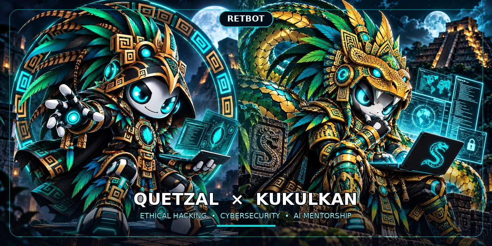

<div align="center">



# 🦜 Quetzal

**Two AI agents for your coding client: an architect who builds and a mentor who teaches**

**Works with OpenCode · Claude Code · Codex · any agent-capable client**

[](INSTALL.md)
[](INSTALL.md)
[](https://github.com/Gentleman-Programming/engram)
[](https://context7.com)
[](LICENSE)

*Think before you code. Architect before you build.*

**🚀 Inspired by [Gentleman AI](https://github.com/Gentleman-Programming/gentle-ai)**

</div>

---

## 🎭 Two Agents, One Ecosystem

<table>
  <tr>
    <td align="center" width="50%" valign="top">
      <br>
      <h3>🦜 Quetzal</h3>
      <b>The architect</b>
      <p>Plans before writing code, reviews critically, and verifies its own changes
      before claiming success.</p>
      <p>Acts directly on small fixes, asks before high-risk or irreversible moves.<br>
      Detects overengineering; applies patterns only when they solve a real problem.</p>
      <p><code>QUETZAL.md</code><br>
      <sub>shell · read · edit · subagent</sub></p>
    </td>
    <td align="center" width="50%" valign="top">
      <br>
      <h3>🐍 Kukulkán</h3>
      <b>The mentor</b>
      <p>Teaches ethical hacking and cybersecurity step by step, and never runs
      commands on your behalf.</p>
      <p>Covers systems, networking, privacy, pentesting, CVEs, blue team, and AI
      security.<br>Designs authorized labs with explicit scope and cleanup.</p>
      <p><code>kukulkan.md</code><br>
      <sub>read only · websearch/webfetch ask</sub></p>
    </td>
  </tr>
</table>

<p align="center">They share the same ecosystem — Engram for memory, Context7 for docs,
the same helper subagents — but they never overlap: <b>Quetzal builds, Kukulkán teaches.</b></p>

---

## ✨ What is Quetzal?

**Quetzal** is both the architect agent and the name of the ecosystem that ships it
alongside **Kukulkán**. The architect brings discipline and strategic thinking to your
development workflow. Unlike agents that over-eagerly jump to implementation, Quetzal:

- 🎯 **Challenges assumptions** — Questions your approach before committing
- 📐 **Designs first** — Architects solutions before writing code
- 🔍 **Reviews critically** — Analyzes and improves existing code
- ⚖️ **Acts with judgment** — Autonomous when it can be, prudent when it must be
- 🧩 **Avoids dogma** — Applies patterns only when they solve a real problem, not by default
- 🚀 **Optimizes for scale** — Builds systems that grow gracefully

### Philosophy

> **Think first, then act — and verify what you change.**

Quetzal doesn't just write code — it helps you build the *right* thing, the *right* way. It asks only the questions that change the outcome, and verifies its own work before claiming success.

---

## 🚀 Quick Start

There is **no installer script**. You install Quetzal by asking an agent to do it.

Open your coding agent — OpenCode, Claude Code, Codex, Cursor, or any other client
that can read files and edit configuration — and paste this:

```text
Install Quetzal and Kukulkán in this client.

Repository: https://github.com/RETBOT/quetzal
Follow the installation prompt at INSTALL.md in that repository, step by step.

Rules:
- Detect which client I'm using and follow only that client's section.
- Back up every config file before editing it.
- Merge into my existing config; never replace providers, models, MCP servers,
  permissions, or unrelated agents.
- Ask before overwriting anything with the same name.
- When done, show me a table of what was installed, where, and how to verify it.
```

The agent clones the repo, copies the prompts, merges the agent entries into your
client's config, and verifies the result. It reads the current docs for your client
version instead of guessing paths.

### What gets installed

| Piece | What it is |
|---|---|
| 🦜 **Quetzal** | Architect agent — plans, builds, reviews, verifies |
| 🐍 **Kukulkán** | Cybersecurity mentor — read-only, teaches step by step |
| 🧩 **2 helper subagents** | `codebase-explorer` (read-only recon) + `independent-reviewer` (read-only review) |
| 🎯 **18 skills** | `code-review`, `refactoring`, `engineering-flow`, `testing` + 4 .NET + 4 web + 5 security (+ `sdd` as legacy) |
| 💾 **Engram** *(optional)* | Persistent memory across sessions |
| 📚 **Context7** *(optional)* | Up-to-date library documentation |

### The installation prompt

[`INSTALL.md`](INSTALL.md) holds the full prompt: per-client steps for OpenCode V2,
Claude Code, and Codex, plus guidance for any other client. Point your agent at that
file — or paste it whole — and it does the work.

It works because an agent can read your current config, detect what's already
installed, merge instead of overwrite, and explain what it changed. A shell script
can't do that for every client without breaking every time a config format changes.

---

## 🧩 Complete Ecosystem

Quetzal comes with a complete AI development ecosystem, inspired by [Gentleman AI](https://github.com/Gentleman-Programming/gentle-ai):

### 🦜 Quetzal Agent
The architect. Writes code, reviews it, and verifies the result.

| What it does | Detail |
|---|---|
| Adaptive workflow | THINK → EXPLORE → PLAN → BUILD → VERIFY → REVIEW |
| Risk-based autonomy | Acts on low/medium risk; confirms before high-risk or irreversible moves |
| Self-verification | Runs tests, build, or lint before claiming success |
| Evidence-based debugging | Reproduce → observe → hypothesize → prove → fix |
| Anti-overengineering | Applies patterns only when they solve a real problem |
| Persistent memory | Saves decisions and hard-won context to Engram |

Reads your project's `AGENTS.md` for stack, conventions, and test commands — that file
wins over the global prompt on operational details.

**Permissions:** `shell`, `read`, `edit`, `subagent` allowed · asks before `git commit`,
`git push`, `git rebase`, `git reset --hard` · denies `.env`, `credentials.json`,
`secrets/**`.

### 🐍 Kukulkán Agent
The mentor. Teaches ethical hacking and cybersecurity, never executes.

| What it does | Detail |
|---|---|
| Teaching, not executing | Shell is denied by design; it explains each command and you decide |
| Authorized labs only | OWASP Juice Shop, isolated VMs, deliberately vulnerable apps |
| Privacy and anonymity | VPN, proxies, Tor, DNS leaks, cookies, fingerprinting, and their real limits |
| Pentesting and CVEs | Scope, methodology, CWE/CVSS, impact, mitigation |
| Blue team | Logs, detection, forensics, incident response |
| AI security | Prompt injection, jailbreaks, RAG and agent tooling risks |

**Study modes** (conversational shortcuts, not terminal commands):

| Shortcut | What it does |
|----------|--------------|
| `/aprender tema` | Explain from fundamentals with guided practice |
| `/practica tema` | Lab with objective, scope, steps, evidence and cleanup |
| `/quiz tema` | One question at a time; waits for your answer |
| `/repasar` | Review and detect gaps |
| `/ruta` | Current unit, prerequisites, next milestones |
| `/analizar archivo` | Analyze material you provide, keeping its terminology |
| `/cve ID` | Affected products, sources, CWE/CVSS, impact, mitigation |
| `/informe` | Reproducible report with sanitized evidence |
| `/continuar` | Resume from available progress |

**Guardrails:** no access to third-party systems, no credential theft, no malware, no
exfiltration of real data, no hiding an intrusion. If scope isn't clear, it asks and
offers a local simulation instead.

**Permissions:** `read` allowed · `shell`, `edit`, `subagent`, `external_directory`
denied · `websearch`, `webfetch` ask.

> *"Primero entender, después automatizar."*

### 💾 Engram (Persistent Memory)
[Engram](https://github.com/Gentleman-Programming/engram) remembers decisions, bugs, and context across sessions.

**What it does:**
- Saves architectural decisions automatically
- Remembers bugs and how you fixed them
- Maintains project context across sessions
- Syncs memories via git (share with your team!)

**Commands:**
```bash
engram tui              # Browse memories visually
engram search "auth"    # Find past decisions
engram sync             # Export to git
```

### 📚 Context7 (Library Documentation)
[Context7](https://context7.com) provides up-to-date documentation for any library.

**What it does:**
- Fetches latest docs for React, Next.js, any library
- No more outdated training data
- Code examples from the source
- Works with any version you specify

**How to use:**
Just ask Quetzal anything about a library:
```
"How do I configure Next.js middleware?"
"Show me Supabase auth API examples"
"What's the new React 19 feature?"
```

### 🎯 Skills (Specializations)
Quetzal includes specialized **skills** in the native OpenCode format (`SKILL.md` with YAML frontmatter). OpenCode discovers them automatically from the skills directories — no manual triggers needed.

| Skill | Frontmatter `name` | When to use |
|-------|--------------------|-------------|
| **🔍 code-review** | `code-review` | "Review this code" |
| **🔨 refactoring** | `refactoring` | "Refactor this", "simplify this" |
| **⚙️ engineering-flow** | `engineering-flow` | "How much process does this need?", multi-file changes |
| **🧪 testing** | `testing` | "Run tests", "TDD", "coverage" |
| **🗄️ dotnet-efcore** | `dotnet-efcore` | EF Core, LINQ, migrations, slow queries |
| **📱 dotnet-maui** | `dotnet-maui` | .NET MAUI, Android/iOS/Windows, navigation, binding |
| **🪟 dotnet-windows-forms** | `dotnet-windows-forms` | .NET WinForms, Designer, RESX, csproj, build errors |
| **🌐 aspnet-mvc** | `aspnet-mvc` | ASP.NET MVC, Razor, controllers, CSRF |
| **⚛️ react-frontend** | `react-frontend` | React components, hooks, re-renders, state |
| **📊 devextreme** | `devextreme` | DataGrid, CustomStore, `DataSourceLoader`, virtual scrolling |
| **🟨 javascript-web** | `javascript-web` | DOM, jQuery, AJAX, async, client-side XSS |
| **🔌 api-design** | `api-design` | REST contracts, versioning, errors, idempotency |
| **🕸️ network-analysis** | `network-analysis` | TCP/IP, DNS, TLS, `tcpdump`, pcap analysis |
| **🎯 web-api-pentest** | `web-api-pentest` | Authorized web/API pentest, OWASP, BOLA |
| **🧾 vulnerability-triage** | `vulnerability-triage` | "Does this CVE affect me?", CVSS, CWE |
| **🤖 llm-security** | `llm-security` | Prompt injection, RAG, tool abuse, MCP |
| **🧪 security-lab-design** | `security-lab-design` | Isolated labs, reproducibility, cleanup |
| **📋 sdd** *(legacy)* | `sdd` | Retired from the active path — see [LEGACY-SDD-RETIREMENT](docs/v2.1/LEGACY-SDD-RETIREMENT.md) |

Quetzal invokes the matching skill with the `skill` tool based on its `description`.

Skills live in `/skills/<name>/SKILL.md` and are customizable. On install they are copied to `~/.config/opencode/skills/` for global discovery.

### 🚀 Project Commands (Essential Pack)
Commands that configure and manage your project:

```bash
./commands/project-init      # Initialize project with Quetzal
./commands/skill-registry    # Scan and register available skills
```

`./commands/sdd-init` is **legacy** and scheduled for retirement; the active flow is
`workflows/engineering-loop.md`.

**Usage example:**
```bash
cd my-project
../quetzal/commands/project-init    # Configure Quetzal
../quetzal/commands/skill-registry  # Register skills
```

### 📋 Workflows (Work Flows)
Predefined workflows for common situations:

| Workflow | Description | File |
|----------|-------------|---------|
| **engineering-loop** | **Active path** — proportional 8-step flow | `workflows/engineering-loop.md` |
| **feature-workflow** | Create new feature | `workflows/feature-workflow.md` |
| **bugfix-workflow** | Fix bugs with root cause analysis | `workflows/bugfix-workflow.md` |
| **refactor-workflow** | Safe refactoring step by step | `workflows/refactor-workflow.md` |
| **pr-workflow** | Create and review Pull Requests | `workflows/pr-workflow.md` |

### 🎛️ Presets (Operating Modes)
Presets for different contexts:

| Preset | Coverage | Flow | Approvals | When to use |
|--------|----------|------|-----------|-------------|
| **strict-mode** | 80% minimum | Engineering loop, full checks | 2 | Enterprise, critical code |
| **fast-mode** | 60% target | Engineering loop, inline | 1 | MVPs, prototypes |
| **team-mode** | 70% target | Engineering loop + conventions | 1 + conventions | Teams 3-10 devs |

**Change preset** in `.quetzal/config.json`:

```json
{
  "mode": "strict"
}
```

Valid values: `strict`, `fast`, `team`.

**Add your own:** drop a Markdown file in `presets/<name>.md` with the rules, coverage
target, and approval count, then select it the same way. Workflows follow the same
pattern in `workflows/<name>.md`; project commands are bash scripts in `commands/`
(mark them executable with `chmod +x`).

---

## 📋 Requirements

| Tool | Required | For | Notes |
|------|----------|-----|-------|
| **An agent** | ✅ Yes | Installation | OpenCode, Claude Code, Codex, or any client that can read files and edit config |
| **Git** | ✅ Yes | Installation | For cloning the repository |
| **Node.js** | ⚪ Optional | Context7 | `npm install -g @upstash/context7-mcp` |
| **Go** | ⚪ Optional | Engram | Build from source |

### Optional Components

**Without Node.js:** Context7 won't install, but Quetzal works fine
**Without Go:** Engram won't install, but Quetzal works fine

Both are **optional** — Quetzal functions as a standalone agent.

---

## 🎭 How Quetzal Decides

Quetzal adapts behavior based on task type and risk. It acts autonomously when it can
and asks for confirmation only when it should.

| Task type | Quetzal behavior |
|-----------|------------------|
| Conversation / analysis / review / research | No file changes, analyzes and responds |
| Trivial change (typo, rename, 1-line fix, docs) | Acts directly if intent is obvious, then verifies |
| Small-moderate change, clearly requested | Acts directly, verifies, reports what changed |
| Relevant / architectural / multi-file | Brief plan; medium risk proceeds with verification, high risk asks confirmation |
| Explicit implementation request | Implements and verifies, no re-asking |
| Debugging | Evidence-based workflow, fixes when root cause is clear |
| Refactoring | Safe and incremental with tests; asks if large or no tests |

**Risk levels:** **Low** (local, reversible) → act. **Medium** (logic, multi-file) → act if intent is clear, verify. **High** (destructive, irreversible, secrets, mass, production) → confirm.

### Example Interactions

```
User: "Plan an authentication system"
Quetzal: Understands, explores, presents a brief plan with real alternatives,
         and asks only the questions that change the implementation

User: "Build the auth module"
Quetzal: Implements and verifies. Doesn't re-ask for permission.

User: "Review this code"
Quetzal: Analyzes, suggests improvements, flags issues. Doesn't modify files.

User: "Fix this typo in the README"
Quetzal: Fixes it directly and confirms what changed.

User: "How do I use React useEffect?"
Quetzal: Consults Context7 only if the API/version matters, or explains from knowledge.

User: "Remember we decided to use TypeScript strict"
Quetzal: Saves the architectural decision to Engram.
```

---

## 🏗️ Architecture

```
┌─────────────────────────────────────────────────────────────┐
│      Your coding client (OpenCode · Claude Code · Codex)    │
└─────────────────────────────────────────────────────────────┘
                              │
        ┌─────────────────────┼─────────────────────┐
        │                     │                     │
        ▼                     ▼                     ▼
┌──────────────┐    ┌─────────────────┐    ┌──────────────┐
│ Quetzal /    │    │     Engram      │    │   Context7   │
│ Kukulkán     │    │  (Memory)       │    │   (Docs)     │
├──────────────┤    ├─────────────────┤    ├──────────────┤
│ Markdown     │    │ ~/.engram/      │    │ context7.com │
│ prompts      │    │ SQLite          │    │ MCP Server   │
│ (portable)   │    │ Persistent      │    │ Latest docs  │
└──────────────┘    └─────────────────┘    └──────────────┘
```

### Project Structure

```
quetzal/
├── quetzal/
│   └── QUETZAL.md              # Architect agent behavior (compact prompt)
├── kukulkan/
│   └── kukulkan.md             # Cybersecurity mentor prompt
├── quetzal.png                 # Quetzal logo
├── kukulkan.png                # Kukulkán logo
├── banner.jpg                  # Social preview / README hero (1280×640)
├── skills/
│   ├── code-review/SKILL.md
│   ├── refactoring/SKILL.md
│   ├── engineering-flow/SKILL.md      # Active path (replaces sdd)
│   ├── testing/SKILL.md
│   ├── dotnet-efcore/SKILL.md
│   ├── dotnet-maui/SKILL.md
│   ├── dotnet-windows-forms/SKILL.md
│   ├── aspnet-mvc/SKILL.md
│   ├── react-frontend/SKILL.md
│   ├── devextreme/SKILL.md
│   ├── javascript-web/SKILL.md
│   ├── api-design/SKILL.md
│   ├── network-analysis/SKILL.md
│   ├── web-api-pentest/SKILL.md
│   ├── vulnerability-triage/SKILL.md
│   ├── llm-security/SKILL.md
│   ├── security-lab-design/SKILL.md
│   └── sdd/SKILL.md                   # Legacy — scheduled for retirement
├── agents/
│   ├── codebase-explorer/agent.md     # Read-only recon helper
│   ├── independent-reviewer/agent.md  # Read-only review helper
│   └── sdd-*/agent.md                 # Legacy SDD sub-agents
├── commands/                   # project-init, skill-registry (+ sdd-init legacy)
├── workflows/                  # engineering-loop, feature, bugfix, refactor, pr
├── presets/                    # strict, fast, team
├── docs/v2.1/                  # DECISIONES, migracion y retiro de SDD
├── VALIDATION.md               # Guia y resultados de validacion en vivo (v2.1)
├── INSTALL.md
└── README.md                   # This file
```

Per project, `./commands/project-init` also generates an `AGENTS.md` with the
project's own rules (stack, conventions, tests) — separate from the agent prompt.

---

## 🔄 Updates

Updates work the same way as installation: ask an agent.

```text
Update my Quetzal installation from https://github.com/RETBOT/quetzal.

Compare the repo's agent prompts and skills against what I have installed,
show me what changed, then apply the updates to the same paths.
Back up the config before touching it and keep my local customizations.
```

The agent pulls the latest prompts, diffs them against your installed copies, and
merges the changes. Because your customizations live in the installed files and your
`AGENTS.md`, it can tell the difference between upstream changes and your own edits —
which a blind overwrite cannot.

### What an update covers

- ✅ Quetzal and Kukulkán prompts
- ✅ Helper subagents (`codebase-explorer`, `independent-reviewer`)
- ✅ Skills
- ✅ Agent entries in your client's config
- ✅ `VALIDATION.md` — re-run it after touching config or when OpenCode changes version
- ⚪ Engram and Context7 (only if you ask it to upgrade the binaries)

> **Cambio importante respecto a versiones anteriores del README:** en OpenCode v2.2.5
> los helpers deben ir con `hidden: false` (ver `VALIDATION.md` §1 y el callout de
> `INSTALL.md` §2.3). Con `hidden: true` salen del catálogo `subagent`: Quetzal
> delegará al built-in `explore` pensando que `codebase-explorer` "no existe".
> Determinado empíricamente. Se conserva `mode: subagent`, así que no aparecen en el
> ciclo de agentes principales.

---

## 🔬 Validación y adaptaciones conocidas (OpenCode v2.2.5)

README documenta el diseño objetivo (v2.1). `VALIDATION.md` y `docs/v2.1/MIGRATION.md`
cargan con las áreas grises descubiertas empíricamente. Lo que debes saber antes de
instalar sin leer la guía:

1. **`mode: subagent` es suficiente para ocultar del ciclo de agentes principales.**
   No es suficiente para ocultarse del catálogo que usa la tool `subagent`.
2. **Por eso, en OpenCode, los helpers van con `hidden: false`.** El paquete upstream los
   proponía `hidden: true`, pero a partir de v2.2.5 esa bandera también los saca de la
   evidencia de delegación. Se probó T1 con `hidden: true` y el modelo reportó
   explícitamente: “no existe un agente llamado `codebase-explorer`”.
3. **Permisos: la última regla gana** (`permissions` y `agents.<id>.permissions`).
   Mientras el `deny` amplio vaya primero y las excepciones después, la lectura y el
   shell fuera de git se bloquean correctamente. El `Plan` y `General` built-ins
   empaquetan reglas que se añaden; no asumir un conjunto vacío.
4. **Skills descubiertas:** `~/.config/opencode/skills/` (global) y `.opencode/skills/`
   (proyecto). La entrada `skills` de `opencode.json` suma directorios o URLs, no
   sustituye.
5. **La config se recarga sin reiniciar OpenCode** (`/reload` para un reload forzado).
   Si cambias un `agent` o `permissions` y no se ve, no reinicies — mira el log de
   servicio (`~/.local/share/opencode/log/opencode.log`, rol `server`).

La fuente de verdad operativa es `INSTALL.md` (instalación/configuración), no este README.

---

## 🛠️ Troubleshooting

<details>
<summary>❌ The agent didn't install anything</summary>

Most likely it couldn't detect the client or the config root. Tell it explicitly:

```text
I'm using <OpenCode / Claude Code / Codex>. My config lives at <path>.
Install Quetzal following INSTALL.md from https://github.com/RETBOT/quetzal
```

If the client isn't covered by `INSTALL.md`, ask the agent to map the prompt to that
client's agent/persona location and to report which capabilities it can't honor.
</details>

<details>
<summary>❌ Agents don't show up after installing</summary>

Configs are read at startup. Restart the client, then verify:

- **OpenCode:** `opencode api get /api/agent` — every agent must be listed with the
  right `mode` and `hidden`.
- **Claude Code:** `/agents` inside a session.
- **Codex:** the agent files must be under `~/.codex/agents/`.

If the agent edited the config but the client ignores it, check that it merged into
the correct key for your version — V2 uses `agents`, not `agent`.
</details>

<details>
<summary>⚠️ Context7 not working</summary>

**Install Node.js first:**
- **Windows:** https://nodejs.org/ (LTS version)
- **macOS:** `brew install node`
- **Linux:** `sudo apt install nodejs npm`

Then install the server:
```bash
npm install -g @upstash/context7-mcp
```

Ask the agent to add it to your client's MCP config, or see
[Manual Configuration](#-manual-configuration).
</details>

<details>
<summary>⚠️ Engram not working</summary>

**Install Go first:**
- All platforms: https://go.dev/dl/

Then build it:
```bash
git clone https://github.com/Gentleman-Programming/engram.git
cd engram && go build -o ~/.local/bin/engram ./cmd/engram
```

Confirm with `engram --version` before asking the agent to wire it up. Quetzal works
without Engram — you only lose persistent memory.
</details>

<details>
<summary>⚠️ The agent overwrote part of my config</summary>

It shouldn't — `INSTALL.md` requires a backup before every edit. Look for
`<config>.bak-<timestamp>` next to the original and restore it.

Then re-run the installation, telling the agent explicitly to merge instead of
replace. If it happens again, install manually with
[Manual Configuration](#-manual-configuration).
</details>

<details>
<summary>⚠️ Which agent is active?</summary>

- **OpenCode:** `Tab` or `/agent` cycles primary agents; `quetzal` and `kukulkan` are
  the visible ones. (`sdd-orchestrator` is still visible until the SDD retirement
  completes.)
- **Claude Code:** `claude --agent quetzal` starts a session as Quetzal; otherwise
  they're subagents invoked by description.
- **Codex:** pick the agent when starting the session.

Prompt changes apply to **new sessions only**. Restart the session to see them.
</details>

---

## 🔧 Changes and Modifications

This section documents customizations made on top of Gentleman AI base.

### v2.1 Architecture (current)

The active architecture is **two principal agents plus two read-only helpers**:

```
User
 ├── Quetzal (principal: designs, questions, implements, verifies)
 │    ├── codebase-explorer   (internal subagent, read-only)
 │    ├── independent-reviewer (internal subagent, read-only)
 │    └── Kukulkán            (security subagent, also user-selectable)
 └── Kukulkán (selectable principal: mentor and security specialist)
```

| Piece | Role | Tools |
|---|---|---|
| `quetzal` | Principal. Owns implementation and integration. | shell, read, edit, subagent |
| `kukulkan` | Security specialist. Read-only; reports findings, never executes. | read; shell/edit/subagent denied; websearch/webfetch ask |
| `codebase-explorer` | Read-only reconnaissance. Returns paths, lines, flow, dependencies. | read, glob, grep |
| `independent-reviewer` | Read-only review. Returns findings, never fixes them. | read, glob, grep + shell **only** for `git diff` / `git status` |

Design decisions live in [`docs/v2.1/DECISIONS.md`](docs/v2.1/DECISIONS.md); the
proportional workflow lives in [`workflows/engineering-loop.md`](workflows/engineering-loop.md).

### SDD Agent Structure (legacy)

> **Status: scheduled for retirement.** Full rationale in
> [`docs/v2.1/LEGACY-SDD-RETIREMENT.md`](docs/v2.1/LEGACY-SDD-RETIREMENT.md).
> These agents are documented here because they are still present in the repo.

11 SDD agents (Spec-Driven Development) were imported from Gentleman AI. Upstream
retired SDD in favor of ODD, and v2.1 replaces the phase chain with `engineering-flow`
plus two scoped helpers. The agents remain until the retirement completes.

| Agent | Purpose |
|--------|-----------|
| `sdd-init` | Detect stack, testing, and project conventions |
| `sdd-explore` | Explore codebase and investigate ideas |
| `sdd-propose` | Create structured change proposals |
| `sdd-spec` | Write detailed technical specifications |
| `sdd-design` | Create architecture and design documents |
| `sdd-tasks` | Break down specifications into tasks |
| `sdd-apply` | Implement code changes |
| `sdd-verify` | Validate implementation against specifications |
| `sdd-archive` | Archive completed changes and persist state |
| `sdd-onboard` | Guide user through full SDD cycle |
| `sdd-orchestrator` | Coordinate SDD workflows delegating to sub-agents |

### SDD Agent Configuration (legacy)

SDD agents are mostly configured as `subagent` with `hidden: true`, except `sdd-orchestrator` which is configured as `primary` to be visible and directly accessible.

| Agent | Mode | Hidden | Purpose |
|--------|------|--------|-----------|
| `quetzal` | primary | No | Main agent |
| `kukulkan` | primary | No | Cybersecurity mentor |
| `codebase-explorer` | subagent | Yes | Read-only recon |
| `independent-reviewer` | subagent | Yes | Read-only review |
| `sdd-orchestrator` | primary | No | SDD Coordinator (legacy) |
| `sdd-init` | subagent | Yes | Detect stack/testing (legacy) |
| `sdd-explore` | subagent | Yes | Explore codebase (legacy) |
| `sdd-propose` | subagent | Yes | Create proposals (legacy) |
| `sdd-spec` | subagent | Yes | Specifications (legacy) |
| `sdd-design` | subagent | Yes | Architecture/design (legacy) |
| `sdd-tasks` | subagent | Yes | Break down tasks (legacy) |
| `sdd-apply` | subagent | Yes | Implement changes (legacy) |
| `sdd-verify` | subagent | Yes | Validate implementation (legacy) |
| `sdd-archive` | subagent | Yes | Archive changes (legacy) |
| `sdd-onboard` | subagent | Yes | Guide SDD cycle (legacy) |

**Tools per agent:**
- **Quetzal**: bash, read, write, edit, subagent
- **Kukulkán**: read only (shell, edit, subagent, external_directory denied; websearch/webfetch ask)
- **codebase-explorer**: read, glob, grep
- **independent-reviewer**: read, glob, grep, shell restricted to `git diff` / `git status`
- **sdd-orchestrator**: bash, read, write, edit, subagent
- **sdd-init**: bash, read
- **sdd-explore**: read
- **sdd-apply**: bash, read, write, edit
- **sdd-verify**: bash, read
- **sdd-onboard**: bash, read, write, edit

### Agent Definition Location

Agent definition files are installed in `~/.config/opencode/agent-defs/` instead of `agents/` to:
- Avoid automatic agent loading from .md files
- Control visibility from `opencode.json`
- Prevent duplicate agents in the UI

### Custom Skills

Additional skills included:
- `code-review` — Code review in Mexican architect style
- `refactoring` — Refactoring techniques
- `engineering-flow` — Proportional engineering workflow (active path)
- `testing` — Unit, integration, and E2E testing
- `dotnet-efcore` — EF Core, LINQ, migrations, tracking, performance
- `dotnet-maui` — .NET MAUI cross-platform, navigation, DI, lifecycle
- `dotnet-windows-forms` — WinForms project, Designer, RESX and build validation
- `aspnet-mvc` — ASP.NET MVC, Razor, controllers, request security
- `react-frontend` — React components, hooks, state, rendering
- `devextreme` — DataGrid, CustomStore, `DataSourceLoader`, virtual scrolling
- `javascript-web` — JavaScript, jQuery, AJAX, DOM, async
- `api-design` — REST contracts, versioning, errors, idempotency, resilience
- `network-analysis` — Networks, protocols, traffic capture (Kukulkán)
- `web-api-pentest` — Authorized web/API pentesting and OWASP (Kukulkán)
- `vulnerability-triage` — CVE/CWE/CVSS, impact and mitigation (Kukulkán)
- `llm-security` — Prompt injection, RAG, agents, MCP (Kukulkán)
- `security-lab-design` — Isolated labs, reproducibility, cleanup (Kukulkán)
- `sdd` — Spec-Driven Development (legacy, scheduled for retirement)

All skills except `engineering-flow` and `dotnet-windows-forms` are: *scaffolds
reconstructed from `docs/v2.1/SKILLS-REGISTRY.md`*, because the upstream v2.1 package
arrived incomplete. Each one says so at the top; replace them when the reference
version is available.


---

## 📝 Manual Configuration

Quetzal is a Markdown prompt plus one config entry — you can wire it by hand in five
minutes. [`INSTALL.md`](INSTALL.md) has the exact JSON for every client; this is the
shape of the work.

1. **Copy the prompts.** `quetzal/QUETZAL.md`, `kukulkan/kukulkan.md`, and the two
   helper prompts (`agents/codebase-explorer/agent.md`, `agents/independent-reviewer/agent.md`)
   go into your client's agent directory. On OpenCode that's
   `~/.config/opencode/agent-defs/<name>/`. The legacy `agents/sdd-*/agent.md` files
   only need copying if you still want the old SDD chain.
2. **Copy the skills.** `skills/<name>/SKILL.md` → `~/.config/opencode/skills/`.
3. **Register each agent** in `~/.config/opencode/opencode.json` under `agents`, with
   `system` pointing at the prompt file you just copied:

   ```json
   {
     "agents": {
       "quetzal": {
         "system": "{file:./agent-defs/quetzal/QUETZAL.md}",
         "description": "Principal architect and mentor for scalable, maintainable systems",
         "mode": "primary",
         "permissions": [
           { "action": "shell", "resource": "*", "effect": "allow" },
           { "action": "read", "resource": "*", "effect": "allow" },
           { "action": "edit", "resource": "*", "effect": "allow" },
           { "action": "subagent", "resource": "*", "effect": "allow" }
         ]
       }
     }
   }
   ```

   Kukulkán and the helper subagents use the same shape with different `mode`, `hidden`,
   and `permissions`. The full table is in [`INSTALL.md`](INSTALL.md).
4. **Add the safety rules** to the top-level `permissions` array. V2 evaluates it in
   order and the **last matching rule wins**, so `deny` goes after the catch-all:

   ```json
   {
     "permissions": [
       { "action": "shell", "resource": "*", "effect": "allow" },
       { "action": "shell", "resource": "git commit *", "effect": "ask" },
       { "action": "shell", "resource": "git push *", "effect": "ask" },
       { "action": "shell", "resource": "git rebase *", "effect": "ask" },
       { "action": "shell", "resource": "git reset --hard *", "effect": "ask" },
       { "action": "read", "resource": "*", "effect": "allow" },
       { "action": "read", "resource": "**/.env", "effect": "deny" },
       { "action": "read", "resource": "**/.env.*", "effect": "deny" },
       { "action": "read", "resource": "**/credentials.json", "effect": "deny" },
       { "action": "read", "resource": "**/secrets/**", "effect": "deny" }
     ]
   }
   ```
5. **Verify.** The config is read at startup, so restart the client and check:

   ```bash
   opencode api get /api/agent
   ```

   Every agent must appear with the right `mode` and `hidden`. If one is missing, the
   `system` path is wrong or the JSON has a syntax error.

> **Note:** agents can also be defined per-file in `.opencode/agents/<name>.md` (YAML
> frontmatter + body as prompt). Quetzal uses `opencode.json` + `agent-defs/` so
> permissions live in one place and visibility stays under your control.

Optional MCP servers (`context7`, `engram`) live under `mcp.servers` in the same file;
the snippets are in [`INSTALL.md`](INSTALL.md). Both are optional — Quetzal runs without
them, you just lose fresh library docs and persistent memory.

---

## 🎯 Why Quetzal?

Most AI coding assistants:
- ❌ Jump straight to implementation
- ❌ Don't question your approach
- ❌ Optimize for speed over quality
- ❌ Forget context between sessions
- ❌ Use outdated library docs

Quetzal + Ecosystem:
- ✅ **Thinks before acting** — Architecture first
- ✅ **Challenges you** — Better solutions through questioning
- ✅ **Builds for longevity** — Scalable, maintainable systems
- ✅ **Remembers everything** — Persistent memory with Engram
- ✅ **Always up-to-date** — Latest docs with Context7
- ✅ **Teaches while working** — Explains the "why"

---

## 🌟 Features

- 🚀 **Cross-platform** — Linux, macOS, Windows
- 🤖 **Client-agnostic** — OpenCode, Claude Code, Codex, or anything else
- 🔄 **Agent-assisted updates** — Ask an agent to diff and merge the latest version
- 🔗 **Portable prompts** — Plain Markdown with no client-specific frontmatter
- ⚙️ **Zero config** — Works out of the box
- 📦 **Same repo everywhere** — One source of truth per client
- 🧠 **Memory** — Remembers across sessions (Engram)
- 📚 **Knowledge** — Always fresh docs (Context7)
- 🤝 **Inspired by** — Gentleman AI ecosystem

---

## 🤝 Contributing

Found a bug? Have an idea? Contributions welcome!

1. Fork the repository
2. Create your feature branch (`git checkout -b feature/amazing`)
3. Commit your changes (`git commit -m 'Add amazing feature'`)
4. Push to the branch (`git push origin feature/amazing`)
5. Open a Pull Request

---

## 📜 License

MIT License — see [LICENSE](LICENSE) file for details.

---

## 🙏 Acknowledgments

This project is inspired by and compatible with the [Gentleman AI](https://github.com/Gentleman-Programming/gentle-ai) ecosystem:

- **Engram** — Persistent memory system by Gentleman Programming
- **Context7** — Library documentation by Upstash
- **OpenCode** — AI coding agent platform

Named after the [resplendent quetzal](https://en.wikipedia.org/wiki/Resplendent_quetzal) 🦜 — a bird that doesn't settle for ordinary nests.

---

<div align="center">

**[⬆ Back to Top](#-quetzal)**

Made with 💜 by developers who care about craft

</div>
